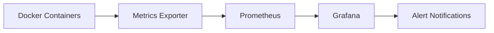

# Hemaa Mathiyarasu

### AI & Data Systems Engineer

`Enterprise AI` · `Graph Data` · `Intelligent Systems` · `Observability`

 

Building intelligent solutions and reliable engineering systems.

 

---

## 👋 Hello, World!

I'm Hemaa, an AI & Data Science graduate working across enterprise AI, graph data systems, and infrastructure observability.

I enjoy solving engineering problems, understanding system architecture, and making complex systems easier to use and maintain.

---

## ⚡ Engineering Domains

| 🤖 Enterprise AI | 🔗 Graph Systems | 📊 Observability |
|:---:|:---:|:---:|
| Intelligent retrieval | Graph data workflows | Container monitoring |
| PLM information systems | Neo4j & Cypher | Grafana & Prometheus |
| AI-assisted workflows | Data validation | Alerting & diagnostics |

---

## 🚀 Featured Engineering Work

### 🤖 AI-Powered PLM Chatbot

Making enterprise engineering information easier to access through AI-powered interactions and retrieval.

`Enterprise AI` `PLM` `Information Retrieval`

 

---

### 🔗 Neo4j Graph Data Workflows

Graph data loading, relationship validation, and Cypher-based data operations for PLM systems.

`Neo4j` `Cypher` `Data Validation`

 

---

### 📊 Docker Monitoring & Observability

Monitoring Docker container health using metrics, dashboards, and automated alert notifications.

`Docker` `Prometheus` `Grafana`

---

## 🏗️ Engineering Snapshot

### Container Monitoring — Simplified Workflow

A simplified view of the container monitoring workflow.

---

## 🛠️ Technologies & Tools

### Graph & Data Systems

### Infrastructure & Observability

### AI Areas of Interest

---

## 🌐 Explore My Work

### Personal Portfolio Website

A collection of my professional experience, engineering projects, and technical work.

---

**Engineering intelligent systems. Building with purpose.**

